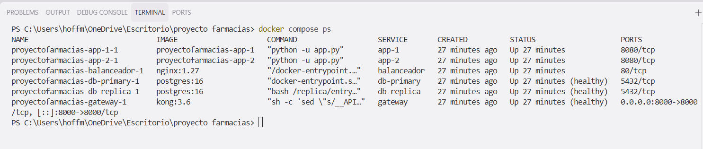
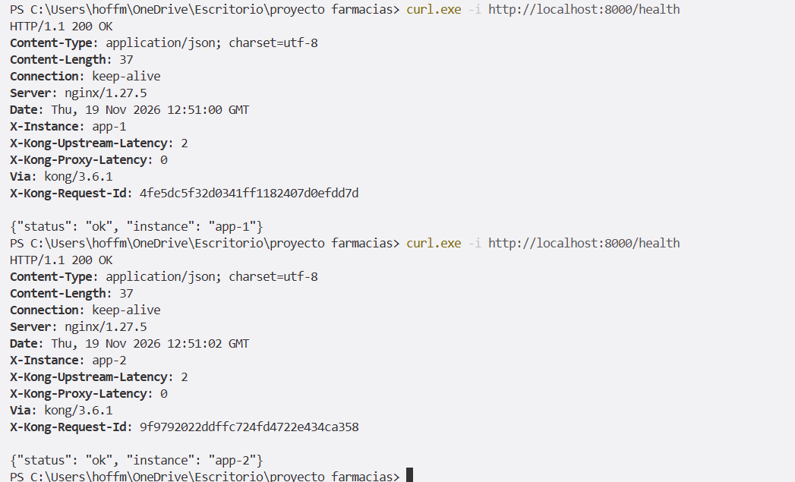
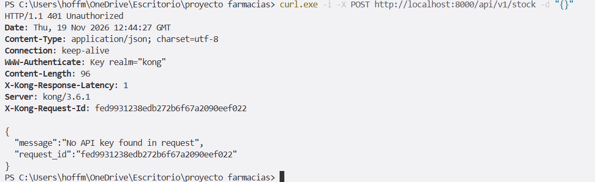
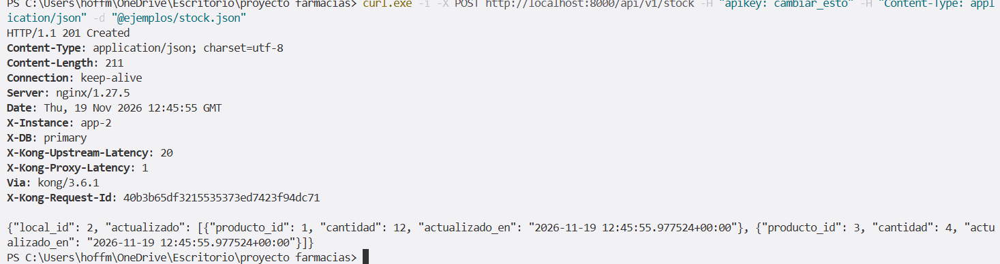
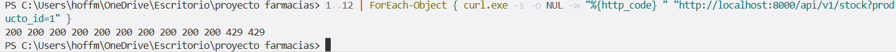
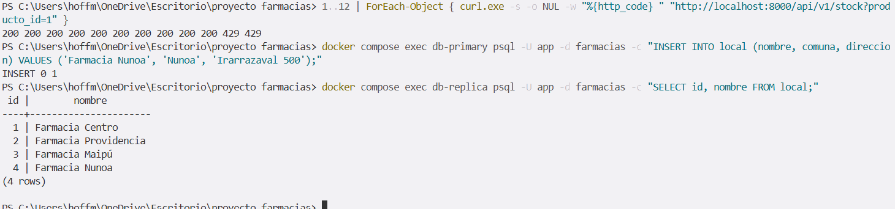

# Stock Farmacias — ISI601 Proyecto individual

API de consulta de stock de una cadena de farmacias con API Gateway, balanceador de carga,
2 instancias de la aplicación y PostgreSQL 16 con réplica por streaming.

```
Clientes ──► Kong (gateway, :8000) ──► NGINX (balanceador) ──► app-1 / app-2
                                                                  │      │
                                              escrituras ──► db-primary ─(WAL)─► db-replica ◄── lecturas
```

- Problemática: [docs/fase1/PROBLEMA.md](docs/fase1/PROBLEMA.md)
- Diseño (Fase 1): [docs/fase1/DISENO.md](docs/fase1/DISENO.md)
- Evidencias (Fase 2): [docs/fase2/EVIDENCIAS.md](docs/fase2/EVIDENCIAS.md)
- Pruebas de falla (Fase 3): [docs/fase3/PRUEBAS_DE_FALLA.md](docs/fase3/PRUEBAS_DE_FALLA.md)
- Bitácora: [BITACORA.md](BITACORA.md)

## Requisitos

- Docker Desktop (con Docker Compose v2) encendido
- Git

## Cómo levantar el sistema (desde cero)

1. Clonar el repositorio y entrar a la carpeta:
   ```bash
   git clone https://github.com/hoffmannnactochsebastianalexan-ux/stock-farmacias-isi601.git
   cd stock-farmacias-isi601
   ```
2. Crear el archivo `.env` a partir del ejemplo (en Windows PowerShell: `copy .env.example .env`):
   ```bash
   cp .env.example .env
   ```
3. Levantar todo:
   ```bash
   docker compose up -d --build
   ```
4. Comprobar que funciona (en PowerShell usa `curl.exe`):
   ```bash
   docker compose ps
   curl -i http://localhost:8000/health
   ```

Para apagar: `docker compose down`. Para borrar también los datos: `docker compose down -v`.

## Cómo probar la aplicación

En Windows PowerShell usa `curl.exe`. Todas las respuestas traen `X-Instance` (qué instancia respondió) y `X-DB` (qué base atendió).

| Acción | Comando | Base |
|---|---|---|
| Salud | `curl.exe -i http://localhost:8000/health` | — |
| Buscar productos | `curl.exe -i "http://localhost:8000/api/v1/productos?q=ibu"` | réplica |
| Stock de un producto por local | `curl.exe -i "http://localhost:8000/api/v1/stock?producto_id=1"` | réplica |
| Locales de una comuna | `curl.exe -i "http://localhost:8000/api/v1/locales?comuna=Santiago"` | réplica |
| Actualizar stock (POS) | `curl.exe -i -X POST http://localhost:8000/api/v1/stock -H "apikey: cambiar_esto" -H "Content-Type: application/json" -d "@ejemplos/stock.json"` | primaria |

Formato del POST: `{"local_id": 2, "items": [{"producto_id": 1, "cantidad": 12}]}`.

### Lectura de lo recién escrito

- El **POST** responde con el stock recién guardado leído desde la **primaria** (`X-DB: primary`), así el POS confirma su propia escritura sin esperar a la réplica (*read-your-writes*).
- Los **GET** leen de la **réplica** (`X-DB: replica`). Justo después de un POST pueden mostrar el valor anterior durante el atraso de la réplica (normalmente menos de 1 s; el objetivo es ≤ 30 s). Cada fila trae `actualizado_en` para saber qué tan reciente es.
- Si la réplica no responde, la aplicación lee de la primaria y lo indica con `X-DB: primary`.

## Evidencias de funcionamiento

Capturas de la terminal con el sistema corriendo (aplicación real, 19 nov 2026).

**1. Los 6 servicios arriba.** Las bases están `healthy` y **solo el gateway publica un puerto** (8000).



**2. El balanceador alterna entre las instancias.** Dos peticiones seguidas a `/health`: la primera la atiende `app-1` y la segunda `app-2` (cabecera `X-Instance`).



**3. Gateway, función 1: API key.** Un POST sin `apikey` se rechaza con `401 Unauthorized`.



**4. Escritura en la primaria.** El mismo POST con la API key del POS responde `201 Created` y `X-DB: primary`.



**5. Gateway, función 2: límite de peticiones.** De 12 lecturas seguidas, 10 responden `200` y las 2 últimas `429`.



**6. La réplica sigue a la primaria.** Se inserta un local en la primaria (`INSERT 0 1`) y aparece al consultar la réplica.



## Componentes

| Servicio | Imagen | Función |
|---|---|---|
| `gateway` | kong:3.6 (sin BD) | Única entrada (puerto 8000). Rutas `/api/v1/*` y `/health`. API key para POST, límite de peticiones para GET |
| `balanceador` | nginx:1.27 | Round-robin entre app-1 y app-2; retira la instancia caída |
| `app-1`, `app-2` | `./app` (Python + psycopg) | Aplicación real, sin estado. POST → primaria, GET → réplica; cabeceras `X-Instance` y `X-DB` |
| `db-primary` | postgres:16 | Escrituras. Crea el usuario de replicación, el slot y el esquema |
| `db-replica` | postgres:16 | Lecturas. Se copia con `pg_basebackup` y sigue a la primaria por streaming |

## Configuración

Las variables están en `.env` (no se sube a Git); `.env.example` tiene valores de ejemplo:
`POSTGRES_*`, `REPLICATION_*`, `DB_PRIMARY_URL`, `DB_REPLICA_URL` y `API_KEY_POS`.

## Decisiones de diseño

| Decisión | Por qué | Costo que acepto |
|---|---|---|
| **Réplica de lectura** y lecturas siempre a la réplica | Hay ~70 lecturas por cada escritura; la primaria queda libre para los POS | Las lecturas pueden estar atrasadas (consistencia eventual, objetivo ≤ 30 s) |
| **Replicación asíncrona** | Las escrituras no esperan a la réplica, y si la réplica cae la primaria sigue escribiendo | En una caída de la primaria se podrían perder las últimas transacciones (RPO > 0 posible) |
| **El POST confirma desde la primaria** | El POS necesita ver lo que acaba de escribir (*read-your-writes*) | Una lectura extra en la primaria por cada escritura |
| **Kong separado de NGINX** | El gateway decide *quién entra y a dónde* (API key, límite, rutas); el balanceador decide *qué instancia atiende*. El enunciado pide separar los roles | Un salto de red más (~1–5 ms) y otro contenedor que configurar |
| **API key solo para escribir; límite de peticiones para leer** | Solo los POS pueden cambiar el stock; el público puede consultar, pero sin saturar el sistema | Los clientes legítimos que pasen el límite reciben 429 |
| **Aplicación sin estado**, con una conexión a la BD por petición | Cualquier instancia atiende cualquier petición; se puede agregar o quitar instancias | Abrir una conexión cada vez es más lento que un *pool* |
| **Fallback a la primaria si la réplica no responde** | Las consultas siguen funcionando aunque caiga la réplica | Esas lecturas cargan la primaria; la cabecera `X-DB` lo deja visible |
| **Kong sin base de datos** (configuración en un archivo) | Más simple: todo está en el repositorio y se levanta con un comando | Para cambiar rutas o claves hay que reiniciar el gateway |
| **NGINX vuelve a resolver los nombres cada 5 s** | Si una instancia se recrea con otra IP, NGINX la encuentra (problema real encontrado en la prueba de falla 3) | Consultas DNS periódicas dentro de Docker |

## Limitaciones

- **Puntos únicos de falla:** hay un solo gateway, un solo balanceador y todo corre en **un solo host** Docker. Si ese computador se apaga, se cae todo.
- **El *failover* de la primaria es manual:** hay que ejecutar `pg_promote()`, cambiar `DB_PRIMARY_URL` y recrear las instancias. En la prueba, con los pasos automatizados en un script, tomó **11 s**; hecho a mano tomaría 1–3 minutos. Herramientas como Patroni lo harían automático.
- **Riesgo de *split-brain*:** si la primaria antigua vuelve a encenderse después de promover la réplica, habría dos primarias. Hay que mantenerla apagada y reconstruirla como réplica.
- **El *fallback* a la primaria es lento:** si la réplica está caída, cada lectura espera el tiempo de conexión (~8 s medidos) antes de ir a la primaria.
- **No se mide el atraso de la réplica dentro de la app:** si la réplica se atrasa más de 30 s, la app no lo detecta sola (se ve con `pg_stat_replication`).
- **El límite de peticiones está en 10 por minuto** para poder demostrarlo; en producción serían 60. Además se cuenta por IP y en memoria de cada gateway (`policy: local`).
- **Seguridad básica:** una sola API key compartida por todos los POS, sin HTTPS, y contraseñas de ejemplo en `.env.example` (solo para clase).
- **Datos de ejemplo:** 3 locales y 3 productos; no hay carga masiva ni pruebas de rendimiento.

## Estado

- [x] Fase 1 — Diseño (etiqueta `fase-1`)
- [x] Fase 2 — Arquitectura en Docker (etiqueta `fase-2`)
- [x] Fase 3 — Aplicación real y [pruebas de falla](docs/fase3/PRUEBAS_DE_FALLA.md)
