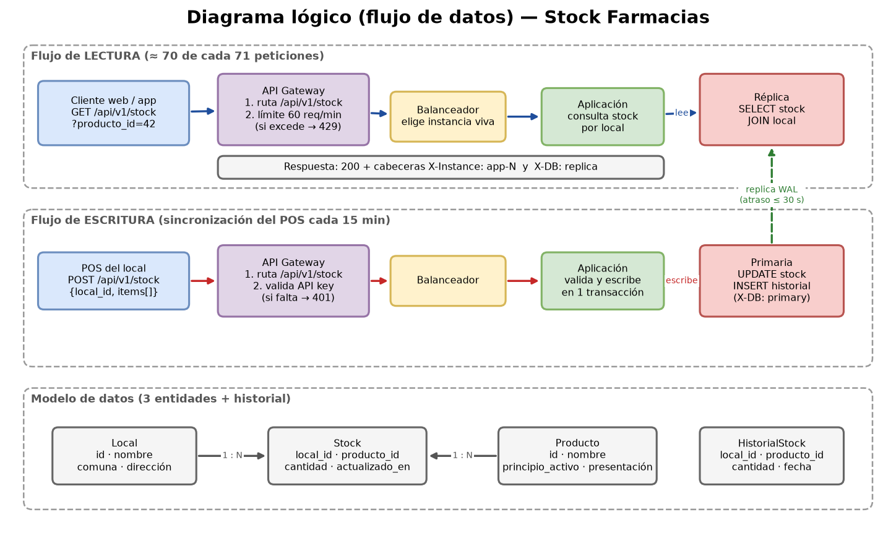
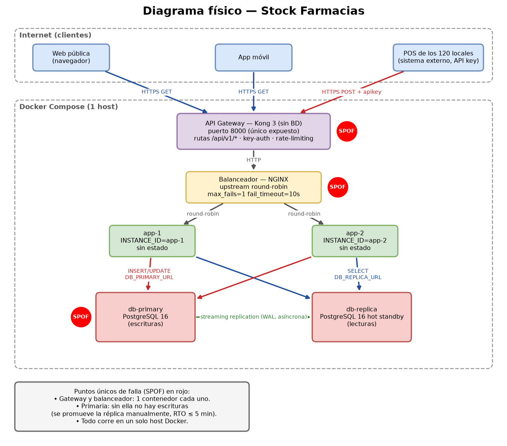

# Documento de diseño — Fase 1

**Proyecto:** Consulta de stock de una cadena de farmacias
**Módulo:** ISI601 Taller de Diseño de Sistemas · Proyecto individual
**Autor:** Sebastian Hoffmann
**Repositorio:** https://github.com/hoffmannnactochsebastianalexan-ux/stock-farmacias-isi601

---

## 1. Problemática

**Quién la usa:** los clientes de una cadena de 120 farmacias (por la web y por una app móvil) y el sistema de caja (POS) de cada local.

**Qué problema resuelve:** hoy el cliente no sabe en qué local está el medicamento que necesita. Llama por teléfono o recorre varios locales. El sistema responde *"¿qué locales tienen el producto X y cuántas unidades?"*.

**Por qué hay muchas más lecturas que escrituras:** miles de clientes consultan, pero solo los 120 locales escriben, y lo hacen por lotes cada 15 minutos:
- 400.000 lecturas al día frente a 5.760 escrituras al día, es decir, **≈ 70 : 1**.

**Cumplimiento de los 5 criterios del enunciado:**

| Criterio | Cifra | Justifica |
|---|---|---|
| Lecturas ≥ 10× escrituras | 70 : 1 | Réplica de lectura |
| Más de un tipo de cliente | Web, app móvil, POS | API Gateway |
| Puede crecer | 17 → 250 lecturas/s en pico (3 años) | Balanceador + instancias |
| Dato cuya pérdida o atraso importa | Stock: atraso ≤ 30 s, RPO ≤ 15 min, RTO ≤ 5 min | RPO, RTO, consistencia |
| Alcance pequeño | 3 entidades, 4 endpoints | Terminable en 3 semanas |

Detalle en [PROBLEMA.md](PROBLEMA.md).

## 2. Requisitos

### Funcionales (8)

| ID | Requisito | Base de datos |
|---|---|---|
| RF1 | Buscar productos por nombre o principio activo | Réplica |
| RF2 | Ver el stock de un producto en todos los locales | Réplica |
| RF3 | Ver el detalle de un local | Réplica |
| RF4 | Listar los locales de una comuna | Réplica |
| RF5 | El POS actualiza el stock de su local por lote | Primaria |
| RF6 | El POS confirma lo recién escrito (*read-your-writes*) | Primaria |
| RF7 | Solo el POS puede escribir (API key) | — (gateway) |
| RF8 | `GET /health` con estado e `INSTANCE_ID` | — |

### No funcionales

| Requisito | Objetivo |
|---|---|
| Latencia de lectura | p95 < 300 ms |
| Latencia de escritura | p95 < 800 ms |
| Disponibilidad de lecturas | 99,5 % mensual |
| Disponibilidad de escrituras | 99 % mensual |
| Atraso máximo de la réplica | ≤ 30 s |
| **RPO** | **≤ 15 min** |
| **RTO** | **≤ 5 min** |
| Límite de peticiones | 60 peticiones/min por cliente público |

## 3. Estimación de carga

**Supuestos principales:**
- 120 locales hoy y 300 en 3 años.
- 200.000 búsquedas al día, con 2 lecturas cada una.
- Cada POS sincroniza cada 15 min durante 12 h al día, con unos 5 productos por sincronización.
- La hora punta concentra el 15 % del tráfico del día.
- En una emergencia sanitaria, el tráfico se multiplica por 5.

| | Promedio | Hora punta | Emergencia / 3 años |
|---|---|---|---|
| Lecturas/s | 4,6 | 17 | 85 / 250 |
| Escrituras/s | 0,07 | 2 (peor minuto) | 5 (300 locales) |

**Almacenamiento a 5 años:**
- Stock actual: ~360 MB.
- Historial de cambios: ~13 GB.
- Con un margen de 1,5×, el total es **≈ 20 GB** (unos 40 GB contando la réplica).

Cálculos completos en [REQUISITOS.md](REQUISITOS.md).

## 4. Diagramas

### Diagrama lógico (flujo de datos)

- **Lectura:** cliente → gateway (límite de peticiones) → balanceador → app → **réplica**.
- **Escritura:** POS → gateway (API key) → balanceador → app → **primaria** → replicación por WAL → réplica.

### Diagrama físico

Los puntos únicos de falla (**SPOF**) están marcados en rojo:
- **Gateway** y **balanceador:** hay un solo contenedor de cada uno; si se cae, no entra ninguna petición.
- **Primaria:** si se cae, no hay escrituras hasta que se promueva la réplica.
- **El host Docker:** todo corre en un solo computador.

Los archivos editables son `diagrama_logico.drawio` y `diagrama_fisico.drawio`.

## 5. Justificación de cada componente

| Componente | Qué problema resuelve | Qué pasaría sin él | Qué costo agrega |
|---|---|---|---|
| **API Gateway (Kong)** | Es la única puerta de entrada para 3 clientes con permisos distintos. Enruta `/api/v1/*`, exige una API key al POS y limita a 60 peticiones/min a la web y la app. | Cada instancia tendría que validar las claves y los límites, con lógica repetida. Cualquiera podría escribir stock falso o saturar el sistema (scraping). | **Latencia:** +2 a 5 ms por petición. **Complejidad:** otro contenedor y otro archivo de configuración. **Dinero:** Kong OSS es gratis; solo cuesta CPU y RAM. |
| **Balanceador (NGINX)** | Reparte las peticiones entre 2 o más instancias y retira la que se cae (`max_fails`). | Una sola instancia no aguanta los 85–250 lecturas/s del pico, y si se cae el servicio cae entero. | **Latencia:** +1 ms. **Complejidad:** configurar el `upstream` y los health checks. **Dinero:** gratis; necesita una instancia extra de la app. |
| **2+ instancias de la app (sin estado)** | Permiten escalar horizontalmente y tolerar la caída de una instancia. | Habría un punto único de falla en la lógica, sin forma de crecer. | **Dinero:** el doble de CPU y RAM. **Complejidad:** la app no puede guardar nada en memoria ni en disco. |
| **Primaria PostgreSQL 16** | Es la única fuente de verdad del stock y recibe todas las escrituras. | No hay alternativa: se necesita almacenamiento persistente. | Es el SPOF de las escrituras. |
| **Réplica por streaming** | Atiende las ~70 de cada 71 peticiones que son lecturas, así la primaria queda libre para escribir. También sirve de respaldo para promoverla si la primaria cae. | Toda la carga iría a la primaria. Con una caída de la primaria se perderían las lecturas **y** las escrituras, y el RTO sería mucho mayor. | **Consistencia:** las lecturas pueden estar atrasadas (≤ 30 s). **Dinero:** el doble de disco (~40 GB). **Complejidad:** dos cadenas de conexión (`DB_PRIMARY_URL` / `DB_REPLICA_URL`). |

**Lectura de lo recién escrito:** el POS confirma lo que acaba de escribir leyendo desde la **primaria** (RF6). Los clientes públicos leen siempre desde la réplica y aceptan un atraso de hasta 30 s.

## 6. Riesgos y mitigación

| # | Riesgo | Impacto | Mitigación |
|---|---|---|---|
| 1 | **Se cae la primaria** | No se puede actualizar el stock. Si la replicación es asíncrona, pueden perderse las últimas escrituras. | Promover la réplica con `pg_promote()`, con un procedimiento documentado y medido (RTO ≤ 5 min). El POS guarda las sincronizaciones que fallan y las reenvía en el siguiente ciclo de 15 min, así el RPO real es de 0 datos de negocio. |
| 2 | **La réplica se atrasa o pierde la conexión** | Los clientes ven stock desactualizado y pueden viajar a un local donde ya no hay. | Monitorear el atraso con `pg_stat_replication`. Mostrar en la respuesta la fecha `actualizado_en`. Si el atraso supera 30 s, la app lee desde la primaria (*fallback*). |
| 3 | **Saturación o abuso** en una emergencia sanitaria (×5 de tráfico o scraping) | Latencia alta y caída de instancias. | Límite de peticiones en el gateway (respuesta 429). Escalar agregando instancias detrás del balanceador sin cambiar código. Un caché en el gateway para las búsquedas más frecuentes. |
